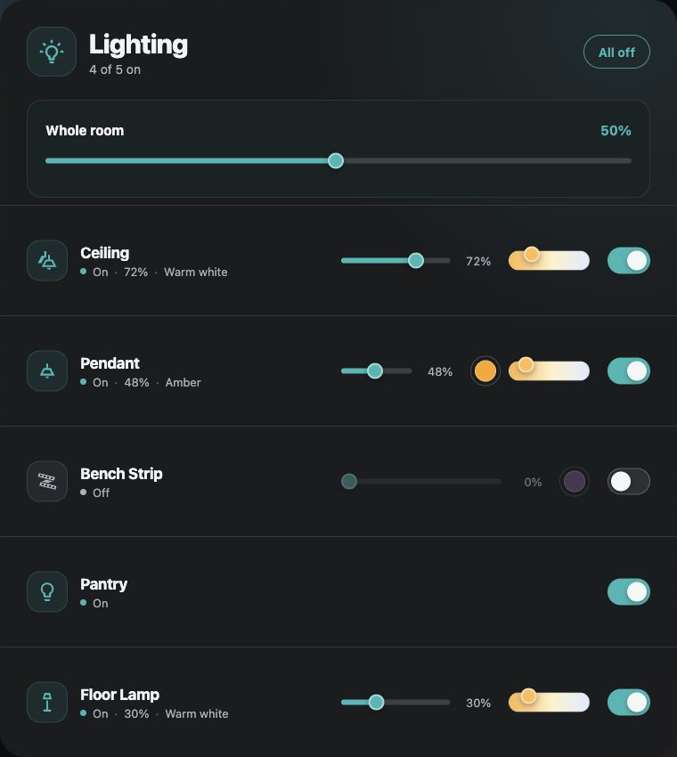

# Multi-Light Card

A capability-aware Home Assistant card for controlling any number of lights
without showing unsupported controls.

Available directly in the default HACS catalogue. Search for **Multi-Light Card**
in HACS; no custom repository is needed.



## Highlights

- Dynamic light list with no fixed entity count.
- Per-light on/off, brightness, and colour-temperature controls.
- Controls appear only when supported by each light.
- Optional whole-room brightness control.
- Native Home Assistant visual configuration.

## Minimal configuration

```yaml
type: custom:multi-light-card
entities:
  - light.ceiling
  - light.floor_lamp
```

See the repository README for complete configuration guidance.

